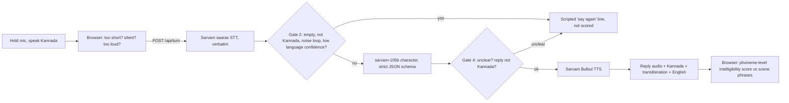

# Maathaadi (ಮಾತಾಡಿ): speak Kannada for real Bengaluru moments

Maathaadi is a mobile-first web app (PWA) where newcomers to Bengaluru rehearse real conversations out loud in spoken Kannada. It has 21 everyday scenes in six life areas, from an auto ride and a darshini breakfast to house hunting, a call to the plumber and Ugadi lunch. An AI character talks back in Kannada. After each line, the app shows **exactly what it heard** and an honest **"would a local understand you?"** intelligibility score, with the specific sounds to fix (ಳ vs ಲ, long vs short vowels, double consonants).

Built for the Kannada Digital Innovation Hackathon 2026.

## What makes it different

- **Goal-based Bengaluru scenes**, not word lists: "Get an auto to Majestic on the meter".
- **Phrases first**: each scene pre-teaches 4 to 5 ready-to-say phrases with audio, transliteration and meaning.
- **In-character correction**: when the character doesn't understand, it says "ಏನು? ಇನ್ನೊಂದ್ಸಲ ಹೇಳಿ" like a real person would.
- **The AI never guesses.** Unclear or inaudible speech is caught in code before the AI sees it, and is never scored (see below).
- **Intelligibility, not accent.** Kanglish and regional Kannada count as correct.
- **No login, no install.** Open the link, tap "Add to home screen". Progress and the daily streak stay on the phone.

## Scenes

| Area | Scenes |
|---|---|
| Getting around | Auto ride, BMTC bus, Namma Metro, Asking the way |
| Food & shopping | Vegetable stall, Darshini breakfast, Grocery shop |
| Home | House hunting, Hiring house help, Calling a plumber (phone), Delivery at the gate (phone) |
| Errands | Phone recharge, At the tailor, At the bank |
| Health & help | Clinic visit, Pharmacy, Lost wallet at the police station |
| People & festivals | Tea stall chat, Meeting a neighbour, Office lunch chat, Ugadi lunch |

Each scene has a level (Starter, Everyday, Confident), a goal with three steps, 4 to 5 pre-taught phrases, a character persona and a scripted demo. Scenes live in `src/lib/scenes/<area>.ts`; adding one is a single object. Health, bank and police characters carry extra guardrails (no medical or legal advice, never ask for PINs or OTPs).

## How a turn works



| Gate | Where | Catches |
|---|---|---|
| 1 | Browser (`src/hooks/useRecorder.ts`) | Under 0.6 s, no speech above the noise floor, clipping, 15 s cap, app backgrounded |
| 2 | Server (`src/lib/server/gates.ts`) | Empty transcript, another language (Hindi, English), repeated-word noise hallucinations, low language confidence |
| 3 | LLM (`src/lib/server/prompt.ts`) | Schema-forced output; must only respond to the exact words heard, never guess |
| 4 | Server (`src/app/api/turn/route.ts`) | Code overrides any "unclear" turn with the scripted repeat line; reply must be Kannada script and short; one retry, then a fallback line |

### Your own situation, and the pocket card

Learners can type a real situation coming up ("Buy tomatoes for ₹20 a kg at Jayanagar market"). `POST /api/plan` asks `sarvam-105b` (strict JSON schema) to write a scene for exactly that: the character, an opening line, 3 to 5 phrases with the learner's item, price and place in spoken Kannada, and a short sample script. Every Kannada line goes through the same script check as character replies; non-Kannada lines are dropped, and a plan with fewer than three good phrases is retried once. The model refuses harmful or deceptive requests. Plans are saved on the phone (`/mine`).

The server signs each plan (HMAC over the scene JSON, key from `PLAN_SIGNING_SECRET` or derived from the Sarvam key). A live turn on a learner's scene is only accepted if the scene is unchanged, so nobody can edit the saved plan into a free general-purpose prompt. Each line also gets its own signature, so `/api/tts` speaks those lines and nothing else. In demo mode, the planner adapts the closest ready-made scene and adds the learner's price as a phrase.

Every scene, built-in or the learner's own, has a **pocket card**: the lines in order with "Say it" (the phone speaks the line when you freeze), "Show" (big Kannada text to show the person), what you might hear back, and lifesaver phrases. Audio is fetched when the card opens, so it still plays offline at the stall, and the screen stays awake.

### Real-time turns

Turns are streamed, so the conversation feels live instead of waiting for one big answer:

1. As soon as Sarvam's speech-to-text returns, the learner sees **"I heard …"** while the character is still thinking.
2. `sarvam-105b` is called with `stream: true`. The reply is read out of the JSON as it is written (`src/lib/server/stream.ts`), and each finished sentence appears on screen at once.
3. Each sentence goes to Bulbul straight away, in parallel, and the audio streams back in order, so the character starts speaking after the first sentence.
4. **Hands-free mode** (toggle on the talk screen or in Settings): the mic opens by itself after the character finishes, and the turn is sent when the learner pauses for about a second. If nobody speaks for 8 seconds it stops and waits for a tap.

The no-guessing rules still hold while streaming: nothing is shown until the model has said whether it understood; an "unclear" turn stops the stream and uses the scripted repeat line; a sentence that isn't Kannada script ends the reply (or, if it's the first, the turn is retried once without streaming). `/api/turn` returns NDJSON events (`heard`, `reply`, `audio`, `done`) when the request has `stream=1`, and plain JSON otherwise. Demo mode streams too, paced like the live service.

Sarvam also has WebSocket APIs for streaming speech-to-text and text-to-speech. They need the API key in a request header, so a browser can't call them directly, and Vercel functions can't hold an incoming WebSocket. Using them (for word-by-word live captions) would need a small relay server on a host such as Render or Fly.io. For short learner turns the streamed pipeline above gets most of the speed-up without it.

After two unclear tries in a row, the app stops asking for repeats and opens hint phrases with slow audio and a "type instead" option.

## Intelligibility score

`src/lib/score.ts` compares the scene's target phrase with what the speech system heard, at the phoneme level (Kannada aksharas → ISO-style phonemes), using a weighted edit distance. Learner-specific errors get labelled tips: dental vs retroflex (ತ/ಟ, ನ/ಣ, ಲ/ಳ), vowel length, double consonants and aspiration (weighted low). Extra words before or after the phrase are free, so "ಸಾರ್, ಮೀಟರ್ ಹಾಕಿ" still matches "ಮೀಟರ್ ಹಾಕಿ". Typed turns are never scored.

## Tech stack

| Layer | Choice |
|---|---|
| App | Next.js 15 (App Router) + Tailwind CSS v4, installable PWA with offline screen |
| Speech-to-text | Sarvam `saaras:v3`, `verbatim` mode, language auto-detect |
| Character | Sarvam `sarvam-105b`, `json_schema` structured output |
| Voice | Sarvam `bulbul:v3`, one voice per character, slow replay |
| Backend | Next.js API routes on Vercel (keys stay server-side) |
| Data | Scenes in `src/lib/scenes/`; progress in `localStorage` |

## Run it locally

```bash
npm install
cp .env.example .env.local   # add SARVAM_API_KEY, or leave it empty for demo mode
npm run dev
```

Open http://localhost:3000. Phones need HTTPS for the microphone, so test on a phone with the deployed URL (or a tunnel).

**Demo mode** runs automatically when no key is set, and can be switched on in Settings at any time (for example during a Sarvam outage). The characters follow a script, and the mic "hears" sample learner lines (some with typical slips, so the scorer has something to show). Typed input is matched against the scene's phrases.

## Deploy to Vercel

1. Push this folder to a public GitHub repo (the hackathon requires one). `.env.local` is git-ignored; never commit keys.
2. Import the repo at vercel.com/new. No build settings to change.
3. Add `SARVAM_API_KEY` under Project Settings → Environment Variables, then redeploy.
4. Open the URL on an Android phone and an iPhone and run one scene end to end.

## Protecting credits

- Per-IP limit of 30 turns an hour (`TURNS_PER_HOUR`), best-effort per server instance.
- Recordings capped at 15 s and 2.5 MB.
- Fixed lines (phrases, openings, scripted replies) are served from a cacheable `GET /api/tts`, so the CDN and the service worker cache them and repeat demos cost nothing.

## Privacy

Audio is sent to Sarvam AI for transcription and is not stored by Maathaadi. Progress never leaves the device.

## Before the demo

- Have a native speaker review the lines in `src/lib/scenes/`; the character copies their register.
- Record 10 test sentences (a few deliberately broken) and tune the Gate 2 thresholds.
- Sarvam's docs say `mode=verbatim` applies to `saaras:v3`; `saaras:v4` adds `keyterms` for place names. Set `SARVAM_STT_MODEL=saaras:v4` to compare.

## Project structure

```
src/app/page.tsx                 Home: streak, phrase of the day, scenes, lifesaver phrases
src/app/scene/[id]               Scene flow: brief → talk → report
src/app/api/turn                 STT → gates → streamed LLM → gates → sentence TTS (or demo engine)
src/lib/server/stream.ts         Reads the reply out of the model's JSON while it streams
src/app/api/tts                  Cached audio for fixed lines (and signed lines from learners' own scenes)
src/app/api/plan                 Writes a scene for the learner's own situation
src/app/mine                     Plan a real conversation; play and pocket card for own scenes
src/app/scene/[id]/card          Pocket card for built-in scenes
src/app/api/transcribe           "Say it again" drill on the report
src/lib/scenes/                  Scene content by life area, phrases, demo scripts
src/lib/kannada.ts               Script checks, transliteration, phoneme tokens
src/lib/score.ts                 Intelligibility scorer
src/hooks/useRecorder.ts         Push-to-talk recorder with Gate 1
public/sw.js, manifest           PWA
```
