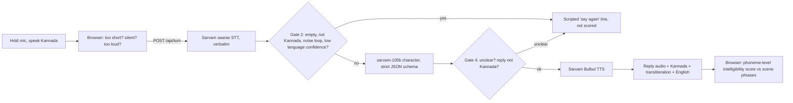

# Maathaadi (ಮಾತಾಡಿ): speak Kannada for real Bengaluru moments

Maathaadi is a mobile-first web app (PWA) where newcomers to Bengaluru rehearse real conversations out loud in spoken Kannada: an auto ride, a vegetable stall, a BMTC bus and a clinic. An AI character talks back in Kannada. After each line, the app shows **exactly what it heard** and an honest **"would a local understand you?"** intelligibility score, with the specific sounds to fix (ಳ vs ಲ, long vs short vowels, double consonants).

Built for the Kannada Digital Innovation Hackathon 2026.

## What makes it different

- **Goal-based Bengaluru scenes**, not word lists: "Get an auto to Majestic on the meter".
- **Phrases first**: each scene pre-teaches 4 to 5 ready-to-say phrases with audio, transliteration and meaning.
- **In-character correction**: when the character doesn't understand, it says "ಏನು? ಇನ್ನೊಂದ್ಸಲ ಹೇಳಿ" like a real person would.
- **The AI never guesses.** Unclear or inaudible speech is caught in code before the AI sees it, and is never scored (see below).
- **Intelligibility, not accent.** Kanglish and regional Kannada count as correct.
- **No login, no install.** Open the link, tap "Add to home screen". Progress and the daily streak stay on the phone.

## How a turn works



| Gate | Where | Catches |
|---|---|---|
| 1 | Browser (`src/hooks/useRecorder.ts`) | Under 0.6 s, no speech above the noise floor, clipping, 15 s cap, app backgrounded |
| 2 | Server (`src/lib/server/gates.ts`) | Empty transcript, another language (Hindi, English), repeated-word noise hallucinations, low language confidence |
| 3 | LLM (`src/lib/server/prompt.ts`) | Schema-forced output; must only respond to the exact words heard, never guess |
| 4 | Server (`src/app/api/turn/route.ts`) | Code overrides any "unclear" turn with the scripted repeat line; reply must be Kannada script and short; one retry, then a fallback line |

After two unclear tries in a row, the app stops asking for repeats and opens hint phrases with slow audio and a "type instead" option.

## Intelligibility score

`src/lib/score.ts` compares the scene's target phrase with what the speech system heard, at the phoneme level (Kannada aksharas → ISO-style phonemes), using a weighted edit distance. Learner-specific errors get labelled tips: dental vs retroflex (ತ/ಟ, ನ/ಣ, ಲ/ಳ), vowel length, double consonants and aspiration (weighted low). Extra words before or after the phrase are free, so "ಸಾರ್, ಮೀಟರ್ ಹಾಕಿ" still matches "ಮೀಟರ್ ಹಾಕಿ". Typed turns are never scored.

## Tech stack

| Layer | Choice |
|---|---|
| App | Next.js 15 (App Router) + Tailwind CSS v4, installable PWA with offline screen |
| Speech-to-text | Sarvam `saaras:v3`, `verbatim` mode, language auto-detect |
| Character | Sarvam `sarvam-105b`, `json_schema` structured output |
| Voice | Sarvam `bulbul:v3`, one voice per character, slow replay |
| Backend | Next.js API routes on Vercel (keys stay server-side) |
| Data | Scenes in `src/lib/scenes.ts`; progress in `localStorage` |

## Run it locally

```bash
npm install
cp .env.example .env.local   # add SARVAM_API_KEY, or leave it empty for demo mode
npm run dev
```

Open http://localhost:3000. Phones need HTTPS for the microphone, so test on a phone with the deployed URL (or a tunnel).

**Demo mode** runs automatically when no key is set, and can be switched on in Settings at any time (for example during a Sarvam outage). The characters follow a script, and the mic "hears" sample learner lines (some with typical slips, so the scorer has something to show). Typed input is matched against the scene's phrases.

## Deploy to Vercel

1. Push this folder to a public GitHub repo (the hackathon requires one). `.env.local` is git-ignored; never commit keys.
2. Import the repo at vercel.com/new. No build settings to change.
3. Add `SARVAM_API_KEY` under Project Settings → Environment Variables, then redeploy.
4. Open the URL on an Android phone and an iPhone and run one scene end to end.

## Protecting credits

- Per-IP limit of 30 turns an hour (`TURNS_PER_HOUR`), best-effort per server instance.
- Recordings capped at 15 s and 2.5 MB.
- Fixed lines (phrases, openings, scripted replies) are served from a cacheable `GET /api/tts`, so the CDN and the service worker cache them and repeat demos cost nothing.

## Privacy

Audio is sent to Sarvam AI for transcription and is not stored by Maathaadi. Progress never leaves the device.

## Before the demo

- Have a native speaker review the lines in `src/lib/scenes.ts`; the character copies their register.
- Record 10 test sentences (a few deliberately broken) and tune the Gate 2 thresholds.
- Sarvam's docs say `mode=verbatim` applies to `saaras:v3`; `saaras:v4` adds `keyterms` for place names. Set `SARVAM_STT_MODEL=saaras:v4` to compare.

## Project structure

```
src/app/page.tsx                 Home: streak, phrase of the day, scenes, lifesaver phrases
src/app/scene/[id]               Scene flow: brief → talk → report
src/app/api/turn                 STT → gates → LLM → gates → TTS (or demo engine)
src/app/api/tts                  Cached audio for fixed lines
src/app/api/transcribe           "Say it again" drill on the report
src/lib/scenes.ts                Scene content, phrases, demo scripts
src/lib/kannada.ts               Script checks, transliteration, phoneme tokens
src/lib/score.ts                 Intelligibility scorer
src/hooks/useRecorder.ts         Push-to-talk recorder with Gate 1
public/sw.js, manifest           PWA
```
